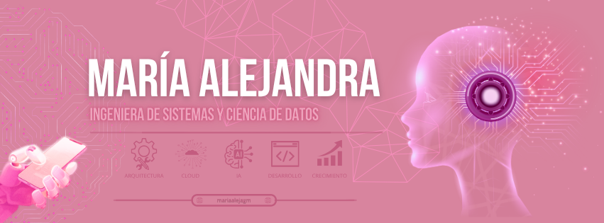

  

# ¡Hola! Soy **Maria Alejandra** 🌸

### Estudiante de Ingeniería de Sistemas + Ciencia de Datos

*Ideas, código y datos: aprendiendo a crear soluciones con propósito.* 

---

## 🌷 Sobre mí

Soy estudiante de **sexto semestre de Ingeniería de Sistemas y Ciencia de Datos**. Me interesa comprender cómo se construye el software, cómo se organizan y analizan los datos, y cómo la tecnología puede ayudar a resolver problemas reales.

- 💻 Me interesa el desarrollo de software, construcción de aplicaciones, computación en la nube y el manejo de la IA.
- 📊 Estoy fortaleciendo mis conocimientos en análisis y procesamiento de datos.
- 🗄️ He trabajado en proyectos académicos relacionados con bases de datos y persistencia de información.
- 🌱 Disfruto aprender nuevas herramientas y mejorar mis proyectos paso a paso.
- 🎯 Quiero construir una trayectoria que conecte desarrollo, datos y soluciones útiles.

> Este perfil reúne proyectos académicos y personales. Cada repositorio describe su propósito, las tecnologías utilizadas y los aprendizajes obtenidos.

<h2 align="center">💻 🎀 Tecnologías y herramientas 🎀 💻</h2>

Estas son algunas de las tecnologías y herramientas con las que he trabajado y continúo fortaleciendo mis conocimientos.

### 👩🏼‍💻✩ Lenguajes de programación

  
  
  
  
  

### ⌨️♡ Desarrollo web y aplicaciones

  
  
  

### ☁️🌸 Bases de datos y análisis

  
  
  
  

### ⚙️✧ Herramientas y fundamentos

  
  
  

## ✨ Proyectos destacados

Reemplaza los ejemplos de esta sección con proyectos reales de tus repositorios. Es mejor mostrar pocos proyectos bien explicados que llenar el perfil con trabajos sin contexto.

<table>
  <tr>
    <td width="50%" valign="top">
      <h3>⌘ Desarrollo de software</h3>
      
<strong>Proyecto:</strong> <em>[Nombre del repositorio]</em>

      
[Describe brevemente qué problema aborda, qué desarrollaste y qué aprendiste.]

      
<strong>Tecnologías:</strong> [Incluye solo las que usaste]

      
<a href="https://github.com/maleegia">Explorar repositorios →</a>

    </td>
    <td width="50%" valign="top">
      <h3>◌ Datos y análisis</h3>
      
<strong>Proyecto:</strong> <em>[Nombre del repositorio]</em>

      
[Describe los datos, el análisis o el modelo y el resultado real del trabajo.]

      
<strong>Tecnologías:</strong> [R / Python / SQL u otras utilizadas]

      
<a href="https://github.com/maleegia">Explorar repositorios →</a>

    </td>
  </tr>
  <tr>
    <td width="50%" valign="top">
      <h3>⌁ Redes y tecnología</h3>
      
<strong>Proyecto:</strong> <em>[Nombre del repositorio]</em>

      
[Cuenta qué configuraste, simulaste o documentaste.]

      
<strong>Herramientas:</strong> [Por ejemplo, Cisco Packet Tracer, si aplica]

      
<a href="https://github.com/maleegia">Explorar repositorios →</a>

    </td>
    <td width="50%" valign="top">
      <h3>♡ Proyecto personal</h3>
      
<strong>Proyecto:</strong> <em>[Nombre del proyecto]</em>

      
[Explica la idea, su estado actual y tu aporte.]

      
<strong>Estado:</strong> [En planificación / En desarrollo / Finalizado]

      
<a href="https://github.com/maleegia">Explorar repositorios →</a>

    </td>
  </tr>
</table>

## 📈 Actividad en GitHub

*Las tarjetas consultan servicios externos y pueden tardar en cargar. Los lenguajes reflejan el código de los repositorios públicos y no representan necesariamente el nivel de dominio.*

## 🌸 Más sobre mí

- 📚 Aprender constantemente y mejorar con la práctica.
- 🧩 Disfrutar la resolución de problemas y el trabajo por etapas.
- 💡 Explorar ideas que conecten software, datos y necesidades reales.

## 📬 Contacto

- **GitHub:** [@maleegia](https://github.com/maleegia)
- **Correo:** [Agrega aquí tu correo profesional, si deseas publicarlo]
- **LinkedIn:** [Agrega aquí tu enlace, si tienes uno]

---

*Gracias por visitar mi perfil.*  
**Aprender · Crear · Evolucionar** ♡

